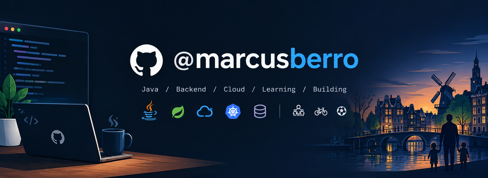

  

# Hi, I'm Marcus 👋

Software Engineer with 20+ years of experience, driven to make a meaningful difference in challenging market areas.

## Strong focus on
- Java
- Spring
- Docker
- Kubernetes
- MySQL

## Other skills
- Object Oriented design - GOF/J2EE
- Domain-Driven Design
- Servlets, SpringMVC, Struts
- SpringBoot and Spring core
- Tomcat, Jetty and JBoss
- JDBC, ORM/JPA, Hibernate, OpenJPA
- RDBMS MySQL and Oracle
- NoSQL DBs MongoDB and Redis
- NodeJS using Restify
- EIPs and Apache Camel
- RESTful, SOA, Web Services
- TDD practices
- Agile with SCRUM and KANBAN
- Javascript, SPA, React, Redux
- Familiar with Unix and Bash
- Maven, Gradle, Ant, GIT, Jenkins, Helm

## Let's connect!

<!--
**marcusberro/marcusberro** is a ✨ _special_ ✨ repository because its `README.md` (this file) appears on your GitHub profile.

Here are some ideas to get you started:

- 🔭 I’m currently working on ...
- 🌱 I’m currently learning ...
- 👯 I’m looking to collaborate on ...
- 🤔 I’m looking for help with ...
- 💬 Ask me about ...
- 📫 How to reach me: ...
- 😄 Pronouns: ...
- ⚡ Fun fact: ...
-->
